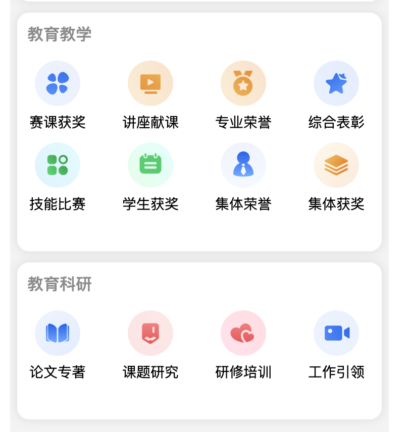

# 教师评价参考资料

| 资料 | 来源与用途 |
| --- | --- |
| [玉林中学建设规划](四川省成都市玉林中学教师专业发展数字化平台建设服务规划方案8.5.docx) | 用户指定重点参考；2025年8月建设规划，含多套示例维度，不等于最终校本考核细则 |
| [乐途产品方案](乐途-教师发展评价产品方案.docx) | 用户提供；用于参考记录、识别、成长档案和学校配置场景 |
| [竞品体验与方案取舍](教师成长记录竞品体验与方案取舍.md) | 2026-10-14登录体验，覆盖当前账号可见分类、档案、看板、学校报表与帮助 |
| [竞品成果分类截图](竞品教师成果分类-用户提供.png) | 用户于2026年10月13日提供；可见教育教学8类、教育科研4类，已在本次教师成长记录体验中确认相同的十二类名称；截图来源仍以用户提供为准 |

截图原文为：教育教学下的赛课获奖、讲座献课、专业荣誉、综合表彰、技能比赛、学生获奖、集体荣誉、集体获奖；教育科研下的论文专著、课题研究、研修培训、工作引领。截图未展示层级扩展、分值、权重、周期与审核角色，方案E中的相关设置属于本项目建议。

