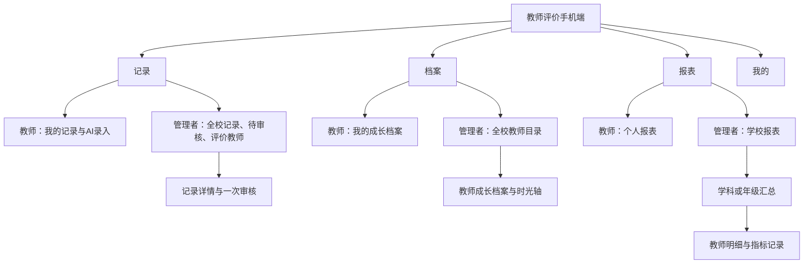

# 教师评价手机端页面结构方案

状态：页面结构建议，2026-10-14。以精简推荐版的4个维度、12个指标举例，尚未选定正式指标方案。本文定义页面和配置衔接，不表示手机端页面已经实现。

## 1. 产品结构

两种身份共用一套手机端：**记录、档案、报表、我的**。教师默认看本人，管理者默认看全校；管理者兼任教师时可查看及录入本人的记录，无需退出或切换账号。

管理者的全校教师数据与学校报表属于本期手机端范围。学校配置指标、发布规则的管理端页面仍不在本期制作。

| 底部入口 | 教师 | 管理者 |
| --- | --- | --- |
| 记录 | 本人提交及涉及本人记录、AI结果、未通过原因与重提 | 记录本人或他人评价；顶部审核待办及已处理事项 |
| 档案 | 本人成长时光轴、指标分数及成果材料 | 全校教师目录，进入任一教师的成长档案；可切到我的档案 |
| 报表 | 本人周期成长数据、指标分布和变化 | 全校概览、学科或年级汇总、教师明细；可切到我的报表 |
| 我的 | 个人信息、学校指标说明、帮助 | 个人信息、两种身份说明、学校指标说明、帮助 |

“全校／我的”是数据视图，不新增角色。教师只显示本人视图，隐藏无权使用的切换控件；管理者在档案和报表清楚显示当前查看范围；记录页区分记录与审核功能。

### 竞品体验后的结构取舍

已逐项体验[教师成长记录](https://tchh5.jxgroup.cn)的当前账号可见入口，覆盖分类列表及表单、时光轴、成长树、荣誉墙、看板、学校人员报表、个人记录及帮助。完整观察与未验证项见[竞品体验记录](参考资料/教师成长记录竞品体验与方案取舍.md)。

借鉴分类、级别、阶段和档案查询，保持四入口。时光轴及按指标查看共用一个档案；图片从记录详情预览。首版不再并列照片库、成长树、荣誉墙，不把职称、人事履历和同龄比较搬进首页。

## 2. 通用配置决定功能

指标配置至少包括以下字段；精简版只是实例，页面不写死4维12项、特定名称或审核名单。

| 配置 | 定义 | 手机端如何使用 |
| --- | --- | --- |
| 评价角色 | 教师、管理者或两者 | 教师评价对象为本人；管理者可评价本校其他教师。未获角色权限的指标不能提交评价 |
| 是否需审核 | 每个末级指标一个开关 | 不需审直接生效；需审进入管理者队列，一次通过即生效。统一适用于该指标的教师及管理者提交 |
| 指标定义及规则 | 纳入／排除条件、必要证据、计分规则、材料类别及适用级别 | AI匹配事实与规则，系统计算分数；只补充确实缺少的信息 |
| 区分等级 | 是／否；等级固定为校级、区级、市级、省级、国家级 | 开启后识别等级，时光轴展示单字标签；关闭时不展示标签，不默认校级 |
| 基础分与上下限 | 周期基础分、上限分、下限分 | 周期初始化、累计计分、档案及报表展示 |
| 考核周期 | 周期起止、结算及跨期规则 | 默认使用学校当前周期，历史查询按已保存版本展示 |

管理者提交时确认的是评价对象、事实及规则匹配结果；若指标需审核，仍由另一名管理者审核，不能用录入确认替代审核。这由同一个审核开关决定，不再设置按身份免审、按心得或成果分流等隐藏例外。不需审核的指标也不因录入人是管理者而增加例行审核。

考核指标、材料类别和成果属性分别保存。指标回答“评价什么”，类别回答“材料是什么”，级别、阶段和本人贡献回答“如何认定”。同一个科研成果指标可以接收不同级别的课题和论文，不能为每个级别新增一层指标，也不将全部成果类别强行映射计分。

账号的数据权限和指标的评价权限分别判断。Demo管理者具有全校数据及报表查看权；能查看某项记录不代表能修改它、替别人填写本人材料或审核自己提交的记录。教师记录自己的材料使用教师权限，即使账号兼任管理者也遵守相同规则。

### 等级开关与自动明细

学校只新增“区分等级”开关，不维护明细字段类型、选项或提取说明。开启后识别校级、区级、市级、省级、国家级，时光轴等位置展示【校】【区】【市】【省】【国】；关闭时显示灰色【个】，代表个人记录，仅作展示分类，不增加等级档位。已开启但无法识别的等级留空，列表保留等宽空位，不默认校级或个人。标签统一为实色底、白字、小圆角方块，保持标题对齐。其他常用明细由平台内置能力提取。

通用识别结果与事项明细仍分为两张卡。第一张显示时间、对象、指标层级及加减分；第二张仅展示实际有值的等级、学时、主办单位、阶段或本人分工，无明细不出现空卡。历史记录保留提交时的设置；关闭等级时不能沿用含等级条件的计分标准。

完整口径见[指标等级与AI识别简化方案](指标方案/指标明细字段与AI识别方案.md)。

### 精简版示例配置

| 指标 | 评价角色 | 是否需审核 |
| --- | --- | --- |
| C01 履职尽责 | 管理者 | 否 |
| C02 关爱学生 | 管理者 | 否 |
| C03 廉洁诚信 | 管理者 | 否 |
| C04 教学实践 | 教师、管理者 | 是 |
| C05 成长支持 | 教师、管理者 | 是 |
| C06 沟通反思 | 教师、管理者 | 否 |
| C07 研修学习 | 教师、管理者 | 否 |
| C08 教研改进 | 教师、管理者 | 否 |
| C09 科研成果 | 教师、管理者 | 是 |
| C10 团队协作 | 教师、管理者 | 是 |
| C11 工作引领 | 教师、管理者 | 是 |
| C12 示范服务 | 教师、管理者 | 是 |

示例不预置三项写作条件、每月首次或培训学时门槛。具体计分额度仍由学校发布；没有计分规则时只归档。

## 3. 记录页：完成录入及处理

### 教师视图

主入口只服务快速录入，不放周期、教师搜索、学科、年级或指标查询筛选。普通教师直接进入记录功能，不展示无法切换的单项Tab；管理者使用与原教师手机端相同的192像素滑动胶囊，切换“记录／审核（待办数）”。两者下方依次是指标入口、简短状态标签、记录卡和底部公共录入条。

记录功能的标签是“全部、已通过、待审核（数量）、未通过（数量）”，数量按当前账号可见记录统计，零值也显示。展示本人提交及涉及本人的记录；管理者提交给他人的评价也保留在其记录中。取消列表年月标题；原始录入顶部以浅色显示录入时间（年-月-日 时:分），与解读区的事件发生日期分开保存。卡片按文本、语音、图片展示原始输入：文本显示原话，语音先显示原始语音条、下方显示转写文字，图片显示缩略图，取消附件式名称。本人文本和语音使用“今天，我……”的口吻；对象为当前账号时标注“(本人)”。AI智能解读采用原教师手机端绿色边框、浅绿表面和分值摘要，内部只依次列出“时间：、对象：、指标：”，级别、贡献随指标显示。不重复展示免审生效、规则说明和查看详情等文案；待审分值明确标待审核，未通过不显示为得分。未通过原因在卡片中完整展示，提交人进入详情后可“修改后重新提交”。不通过不扣分，不能通过重提重复生成成长记录。

记录按发生日期倒序，不受档案或报表周期与搜索条件影响。按时间、指标、类别、级别查询统一在档案完成。规则分值不等于突破上下限后的实际到账积分。

教师说一件事或上传材料，AI识别指标及学校规则。免审自动计分入档；需审自动进入审核队列，不再另点“提交审核”；不足时原位提示补充。提交处理完成后更新同一条记录，避免聊天回复和档案各生成一条重复成果。

### AI录入展开页

从底部录入条直接展开输入或材料选择，先描述事情，不先填指标。日期默认当天，AI优先识别描述中的明确日期；需要调整时再打开日期选择。材料与日期作为辅助入口，不增加独立填写步骤。点击“AI识别并提交”表示提交本次记录；免审且匹配明确的项目直接生效，需要审核的直接进入待审，不增加教师确认页。正式语音、多图、后台识别任务属于后续接入能力；当前Demo语音是可编辑的预置口述，材料是预置摘要，详见使用说明。

| 页面内容 | 展示方式 |
| --- | --- |
| 原始输入 | 教师的文字、语音转写或材料缩略图，可返回核对 |
| 通用识别卡 | 事件发生时间、对象、指标层级、加减分及必要的审核状态 |
| 事项明细卡 | 平台内置提取；等级受指标开关控制，只显示实际识别到的等级、学时、主办单位、阶段、本人分工等 |
| 规则结果 | 指标及已发布规则、生效分值或待审建议分值；依据可展开 |
| 录入校验提示 | 只问当前规则缺少的对象、日期、贡献等，不展开完整表单 |
| 批量结果 | 已生效、待审核分组；识别不足的项目原位提示，不生成待补充业务状态；每项点击进入同一个记录详情 |

多图先判断材料归属：同一证书的正反面或课题材料合并为一件事，多件独立成果分别产生记录。图数不是记录数；材料冲突或归并不确定时请求选择。发现重复时显示旧记录，提供“补充材料”，不自动新增计分。证书信息无法辨认时保留原图并提示重拍或补充文字，不把拍照预处理变成外部应用的必经步骤。

教师无需为已识别字段逐项点确认。已通过内容的更正按原指标权限和审核开关产生修订、重算结果，不能编辑即绕过审核；处理中重试、批量部分重试使用同一任务及事件编号，避免重复入库。

### 管理者视图

顶部“审核（N）”只统计当前管理者有权处理的全部待办，不受考核周期或档案筛选影响；本人提交、涉及本人的需审记录不计入自己的待办。审核功能隐藏录入条，标签为“待审核（数量）、已通过、未通过（数量）”。数量对应当前管理者的列表范围，不受当前标签或考核周期影响；待审核展示有权处理的队列，两个已处理标签展示自己审核过的记录。

录入与审核各自保留标签选择。切换到审核后，只需点击事项即可处理；通过后自动计分，不通过必须写明原因。已处理事项移出待办并实时减少顶部数量。普通教师没有审核功能。

管理者在记录功能可记录本人或其他教师：未指定对象且描述中没有教师姓名时明确以本人作为默认；选择了其他教师或描述中明确写出唯一姓名时，识别后先核对对象再确认。重名、多名或材料与所选对象冲突时要求选人。全校数据查询保留在档案和报表，不在记录首页增加“全校／我的”切换。

管理者可以直接输入“张三老师完成区县级公开课”，AI识别教师及指标。结果卡必须显示教师姓名、指标、事件、规则及分值；姓名重名、不明确或找不到人时提供选人，不依据猜测直接入档。管理者确认提交后按指标审核开关处理。已选教师时可从该教师档案发起评价，沿用明确的评价对象。

### 审核详情

首屏突出教师、事件摘要、指标、规则依据及建议分值，原始文字和附件按需展开。底部主操作“通过”，次操作“不通过”；更正规则匹配放在次级操作中，并保留原因。一次审核包含事实与分值确认，通过后系统计分，无单独人工打分页面。识别字段可定位到原图或原文中的依据；原文未记载的级别、贡献及日期不能作为已证实事实显示。多页附件归属于同一事件，管理者无需逐附件重复审核。

记录详情复用同一页面结构，按状态和权限提供修改重提、不通过、撤回或纠错。自己提交的需审记录不可自审；没有其他管理者能处理时保留待审并提示配置问题，不能自动取消审核。

## 4. 档案页：从教师找到证据

### 教师视图

教师默认打开本人档案，默认当前学期。顶部保留考核周期；一张概览卡集中展示姓名、学校、任教学科、年级、职称、本期积分、已通过记录数和四大维度得分。封面采用暖纸色和书页银杏插画，突出姓名及积分；封面下方提供基本信息、任职信息、资格证书、工作经历四个独立入口，完整资料通过弹层展开，减少首屏重复。成长记录紧随概览卡展示；指标、成果类别及级别统一收进筛选，启用后显示条件标签，可一键清除。

精简版概览显示师德师风、教育教学、研修成长、协作贡献四项得分；按指标视图按这四大维度分组，展示末级指标当前分数及关联记录条数，点击末级指标进入对应时光轴。记录详情展示命中指标的基础分、上下限及规则。后续其他方案按学校配置生成。缺少事件时显示基础分，不据此标注“优秀”。无计分规则时显示档案记录，不显示模拟得分。

### 档案的次级查询

成长记录标题、“时光轴／按指标”切换及筛选入口尽量同行展示，切换保留教师、学期和筛选。时光轴按月分组，日期在左，指标、分值或审核状态、原始表述及适用的级别、本人贡献在右。左侧日期用细线串联，右侧每条记录独立成卡，不重复教师身份；点击记录查看证据和处理历史。进入记录区后，视图切换与筛选工具行吸顶。按指标视图点击末级指标后切回同一时光轴并显示筛选条件。当前 Demo 支持指标、成果类别和级别筛选；阶段／等次及不适用级别的独立筛选待后续配置。

材料在事件详情集中预览，支持查看原图及前后附件。事件标题写实际成果或事项，如“项目化学习课题结题”，类别和级别单列，不拼成“市级其他其他”。已通过但没有计分规则的材料显示“仅归档”，不能用空白分数或“待确认”混淆处理状态。

跨周期查看可选“全部经历”，用于历史档案检索；档案中的当前周期分数仍由明确周期决定。补录旧成果只更新对应发生时间的档案，不能默认加到当前学期。

### 管理者视图

标题“教师档案”，默认全校教师目录。首屏提供姓名搜索、当前学期和学科筛选；年级等次级条件放筛选弹窗。教师条目展示姓名、年级、学科、职称、周期得分（启用计分时）和已通过记录数；不按材料多少默认评优，也不默认按分数排名。

点击教师进入同一成长档案页面，标题始终显示对象姓名。管理者可看其基本资料、任职、证书、工作经历、分数、时光轴、成果级别、原始证据及处理历史；有指标评价权限时提供“记录表现”。本人需审材料的处理仍由另一名管理者完成。

管理者可切到“我的档案”；查看全校教师数据不要求逐个切换账号。个人未提交的草稿不出现在全校目录和报表中。

## 5. 报表页：成长看板与统计报表

2026-10-16 重新登录竞品，复核职称、数据量、指标要求三个看板，以及人员统计、人员明细、数据填报、信息完善四类报表。将适用功能合并到现有“报表”入口内，页内通过开放式文字页签切换“成长看板／统计报表”，选中项用深色加粗文字和底部短线强调，不使用胶囊底色，不新增主导航。

| 视图 | 教师本人 | 管理者全校 |
| --- | --- | --- |
| 成长看板 | 本期积分、较基础分变化、已通过及待审核记录 | 教师人数、有已通过记录人数、已通过记录、学校待审核 |
| 记录趋势 | 本人已通过记录按月统计 | 当前筛选范围的已通过记录按月统计 |
| 指标与成果分布 | 指标、成果类别、等级，点击查对应记录 | 同样支持，明细显示教师姓名 |
| 指标得分 | 四维十二项的基础分、计分范围、当前分、有效记录数 | 切换“我的”可看本人；从教师名单可进入其档案 |
| 记录统计 | 在看板直接查本人已通过、待审核、未通过记录 | 包含零记录教师，显示本期积分和三种状态的条数；条数进入记录，姓名进入档案 |
| 人员结构 | 不提供全校人员视图 | 按学科、年级、职称、学历查看人数及占比，点击分组展开教师名单 |
| 资料登记 | 在本人档案查看资料 | 基础、任职、资格、经历四类资料的已登记数量及未登记项，点击教师进入档案 |

管理者“统计报表”使用一个选择器切换记录统计、人员结构、资料登记，避免同时堆叠多张表。普通教师直接进入指标得分表，无需选择全校报表类型。学校／我的、周期、姓名、学科、年级条件在图表、表格及记录明细中保持一致；进入档案再返回，保留报表类型和筛选。

### 与 AI 录入衔接

看板分别显示免审通过、审核通过数量；AI 识别后产生的记录沿用同一状态流转，免审直接计入，需要审核的通过后计入。指标、等级、月份和状态的统计均可追溯到原始文字、语音转写或图片，以及 AI 识别结果与处理原因。报表不增加一次重复录入或人工汇总。

资料登记仅表示四类资料是否有内容，不表示材料合规率或教学质量。人员结构、职称与学历取当前教师档案，周期仅约束事件和积分；暂不提供历史人员结构快照。成长趋势以已发生月份为主，保留周期内的零记录月份；如已有后续月份记录，一并展示该月，避免汇总与图表脱节。

职称评审标准、申报日期、同龄比较所需规则与数据尚未提供，本期不生成资格判断或虚构年龄、平均值；不把本校考核指标当作职称评审标准。可比周期的规则与适用范围尚未核对，不显示推测的环比或跨学期累计基础分。本期仍使用演示识别数据，没有接入真实 AI 报表解读服务。

### 统计口径

- 教师人数：所选学校、组织及周期内的适用教师，含没有提交记录的教师。
- 有记录教师人数：上述范围内至少有一条已通过教师成长记录的人数，去重统计。
- 教师成长记录数：一名教师对应一件有效事件计一条；多指标关联、附件、审核意见及重提版本不增加条数。待审、未通过、撤销不进入已通过记录数。
- 待审核记录数：所选范围内尚待审核的记录，排除本人不能审核的记录后，个人待办数可能小于学校待审总数；展示时分别命名“待我审核”和“学校待审核”。
- 维度统计按已关联指标汇总；未关联计分指标的合规归档材料列在“未关联指标”，仍可按材料类别查询。不能为统计完整度强行匹配指标。未关联指标的材料须有学校明确的归档权限及审核策略才进入正式学校档案；未配置时只保存个人待整理材料，不纳入学校报表。一个事件关联多个维度时各维度计关联数，须标注不可相加为总记录数。
- 级别统计只使用学校认定级别；不适用、待确认分别呈现，不将材料自述的国家级直接计入已认定成果。人数、记录条数、学时与分数分别统计，不能画成一个总量。
- 学校报表按事件归属周期统计，录入处理列表按提交时间展示；已结算周期的调整保留版本与更新时间。
- 发起评价次数和教师成长记录数分别统计；一次评价多人计一次发起、按对象产生对应记录。首版先支持明确的单人对象，不因此修改项目原有学生评价统计定义。

## 6. 我的页

显示本人信息、学校、实际拥有的教师／管理者权限、指标说明和帮助。指标说明只读展示当前学校启用的方案、评价角色、是否需审核、基础分及上下限，不在手机端增加指标配置表单。

用户实际只有教师权限时，不能通过选择身份取得管理权限。演示账号切换置于手机壳外的演示工具；同一账号兼任两种身份时，档案和报表按权限提供“全校／我的”视图，记录页提供记录与审核功能，视图切换不改变记录归属及审核规则。

## 7. 关键状态

| 情况 | 页面反馈 |
| --- | --- |
| 没有成长记录 | 档案保留学校配置的基础分，提示开始记录；不显示假记录或优秀结论 |
| 没有发布计分规则 | 记录与档案显示“仅归档”；报表提供记录统计，不生成分数 |
| 需审核但尚未通过 | 记录页显示待审核；未进入有效得分和已通过报表 |
| AI缺少信息 | 针对性追问并保留输入，补充后处理同一条记录 |
| AI无法确认对象或指标 | 提供具体教师或指标候选，不静默替换对象 |
| 无需审核 | 自动通过并同步档案、报表，避免多一个确认入档步骤 |
| 多图包含不同成果 | 合并同一事件的材料，独立成果分别处理；显示各项状态 |
| 批量中的部分材料缺信息 | 只补充相关项，其他已满足条件的项继续按配置生效 |
| 重复成果或重复重试 | 展示旧记录并支持补充材料；不重复生成事件或奖励 |
| 记录被更正或撤销 | 保留处理历史，重新计算有效数据，卡片及报表同步更新 |
| 管理权限被取消或学校变更 | 校验权限后退出全校视图，不能继续使用之前缓存的学校数据 |

## 8. 手机场景评审结论

依据frontend-design-review的任务层级、操作反馈和可信展示原则：四个底部入口分别承载录入处理、对象档案、统计分析、个人工具。审核属于记录页，教师目录属于档案页，避免为所有动作新增常驻入口。

已对照[教师手机端界面规范](../../../design-system/teacher-mobile/TEACHER_MOBILE_UI_GUIDELINES.md)：复用现有字号、图标、至少44像素触控热区、选择控件、日期及底部弹窗。档案、教师目录、学校报表使用纯色分层背景，图表遵循学校现有报告组件规则。用户已授权先制作页面并逐步迭代。第一版复用现有设计令牌及公共组件，不新增局部主题；当前实现与尚待接入能力见[Demo使用说明](教师评价Demo使用说明.md)。

现有“记录、班级、我的”导航服务学生评价；本模块建议“记录、档案、报表、我的”，影响范围仅教师发展评价。新增报表入口的理由是管理者全校查看与分析已成为本期核心任务，藏在个人工具内会增加查找负担。用户已授权此结构用于页面演示，已补入教师手机端规范；四项导航仅作用于教师发展评价模块。

本轮竞品取舍沿用frontend-design-review：录入只保留一个主任务；档案视图和筛选渐进展开；AI识别依据与处理状态可追溯。竞品蓝色主题、立体图标、大幅头图及多入口不直接复制。

本轮不修改共用规范或既有手机端代码。后续页面落地须按适用规范复用组件，原始数据、指标配置、事件计分及报表口径共用同一业务数据来源，避免页面各算各的。

## 9. 演示路径

1. 教师提交研修学习材料，命中不需审核指标，自动入档；有学校计分规则时同步分数。
2. 教师提交科研成果，命中需审核指标；管理者从待审核一次通过，教师档案与学校报表同步更新。
3. 管理者录入已核实的履职事件，AI匹配指标及规则；不需审核时确认提交后生效。
4. 管理者从档案页找到任意教师，按指标及成果级别查看时光轴，再进入个人报表。
5. 管理者从学校报表筛选学科或年级，查看教师明细并查到对应记录。
6. 管理者切到自己的视图提交材料；本人需审材料交由另一名管理者处理。
7. 上传一件成果的两页证明和另一件独立成果，识别为两条记录；其中一件缺信息时只补充该件。重复上传已通过成果不重复计分。
8. 管理者按课题研究、市级、结题查询全校成果，从报表点到对应教师与原图；切换条件后图表、摘要和列表同步变化。
9. 将同一指标的审核开关由否改为是，或调整评价角色配置，下一条记录依新版本处理；历史记录保留原依据。演示修改在手机壳外预置配置，不增加学校管理端页面。

## 第一版页面交付状态（2026-10-14）

右侧环境切换已新增“教师评价”，默认打开教师本人档案；支持两种身份、四个入口、完整教师资料、全校目录及报表、预置识别、直接生效／审核分流、审核不通过、补充重提和撤回。资料维护、真实语音和图片识别、批量材料归并等仍属于后续设计。详见[Demo使用说明](教师评价Demo使用说明.md)，本文其余部分保留完整目标范围，不等同于全部已实现。
