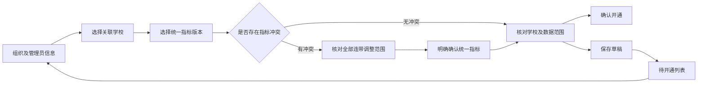

# 学校列表与组织版方案

更新：2026-11-18。目标设备为 PC，服务对象为乐途平台运营人员。范围仅为运营后台学校列表与组织流程；不改学校 PC、教师手机端或既有报表。

## 1. 已确认的业务规则

| 版本 | 管理对象 | 开通方式 | 数据／指标关系 |
| --- | --- | --- | --- |
| 个人版 | 自行注册的个人用户 | 用户自行注册 | 填写的学校名称不等同于合作学校，不自动取得学校管理权限 |
| 学校版 | 合作开通的学校 | 运营合作开通 | 学校是唯一实体，不因加入区级或集团而复制 |
| 组织版 | 统一采购或统筹管理多所学校的组织 | 运营创建组织、关联学校并开通 | 同一组织内所有学校使用同一套学生评价指标 |

- 同一学校可关联任意多个组织，不限制为「一个区级＋一个集团」。例如高新区学校可同时被高新区、成都市及某集团纳入管理范围。
- 组织类型分为「市级教育局 / 区级教育局 / 教育集团」，与实际使用主体对应，不把学校关系强制做成单一父子树。
- 本期全部学校使用完全统一的指标；未来可扩展校本指标，本期不显示尚不可用的开关。
- 指标冲突先处理，再完成关联，不默默覆盖，不用「只能查看数据」绕开统一指标要求。
- 多个组织查看同一所学校时读取同一份学校数据；一个组织的学校集合按学校唯一编码去重。评价次数与成长记录条数分别聚合。

## 2. 列表设计

保留学校管理下的「学校列表」入口，页签调整为「个人版 / 学校版 / 组织版」，默认学校版。使用一张白色主容器，标准页签、筛选、分割线、操作栏、表格和分页，不增加统计卡片。

| 页签 | 高频筛选 | 主要字段 | 本期操作 |
| --- | --- | --- | --- |
| 个人版 | 管理员账号／姓名、账号状态 | 管理员账号、姓名、填写学校、统计信息（创建班级数、创建学生数、评价条数）、注册日期（精确到分钟）、操作 | 查看详情；不提供运营新建个人用户 |
| 学校版 | 学校名称／编号、关联组织、授权状态 | 学校名称、学校编号、已关联组织、学校类型、管理员姓名、管理员手机、拥有教师数、拥有班级数、拥有学生数、授权状态、授权起止时间、学校等级、省／市／区、操作 | 查看学校、查看关联组织；学校名称固定左侧，操作固定右侧，其余字段横向滚动 |
| 组织版 | 组织名称／编码、组织类型、状态 | 组织、类型、关联学校、统一评价指标、管理员、状态 | 新建、查看、草稿继续开通 |

管理员账号作为独立字段展示，学校与组织的联系手机号默认掩码。个人版使用 Arco 标准分组表头，全部表头和内容统一左对齐，包括「统计信息」总表头及其三个子列。账号、姓名、学校、日期、操作按内容长度使用固定列宽令牌，三项统计等分剩余宽度，最小表宽由令牌计算为1040px，窄屏横向滚动；学校列不再拉伸。个人版去掉重复副标题，筛选分割线上下各16px。数值使用千位分隔，零值显示0。详情页统计改用原生 Arco Descriptions，名称与数值左对齐，宽屏三列、窄屏两列。「评价条数」为生成的评价记录条数，不能替换为老师发起评价的次数。注册日期按中国时区显示至分钟，格式为 `YYYY-MM-DD HH:mm`。组织名称与编码在同一列形成主次信息；多组织关联直接展示可点击组织名称；详情在统一抽屉内查看。各版本筛选和分页独立保留，关闭详情回到原列表位置及状态。

学校版学校名称和编号独立成列。学校类型支持小学、初中、高中、九年一贯制、十二年一贯制、幼儿园，学校等级为1星至5星。授权起止时间按日期展示，状态按中国时区自然日判断，开始日期与结束日期当天均为「合作中」，开始前为「未开始」，结束后为「已到期」；列表、详情和筛选共用同一规则。评价指标保留在详情页，不占用主列表。授权展示不修改既有的学校开通与组织关联逻辑，本期仍为演示数据。

## 3. 新建与开通流程

1. **基本信息**：选择市级教育局／区级教育局／教育集团、填写组织名称、管理员姓名和手机号。名称去除首尾空白并查重，手机号校验格式。管理员的真实身份与账号绑定由正式账号服务负责，不因填入手机号就默认完成身份核验。
2. **关联学校**：按学校名称或编码搜索并多选；也可以从已有组织批量添加学校。例如创建成都市组织时，批量纳入高新区已关联学校。重复选择自动去重，学校原有组织关系继续保留。停用学校不可新关联开通。
3. **统一指标**：选择一个明确版本的评价指标方案，可预览一、二、三级指标。与学校现用方案比较，有差异时立即提示，不在此时修改学校配置。
4. **核对开通**：列出组织、管理员、关联学校、目标指标及数据查看范围。存在冲突时，再展示实际会改变指标的学校及已有组织。勾选确认后才能执行「确认开通」或「统一指标并开通」。

每步均可返回，输入不丢失。取消、切换侧栏模块或关闭浏览器时保护未保存输入。字段错误就近显示，下一步校验失败定位到首个错误字段。保存失败保留当前输入，不能显示成功。

**草稿与生效分离**：保存草稿只生成待开通配置，不建立有效数据查看关系，不改变任何学校或已有组织的指标。续办沿用同一组织编码，不重复创建组织。

## 4. 指标冲突与连带范围

同一学校实际只能使用一套生效指标。由于每个组织内部也必须完全统一，指标调整需要沿「组织—学校」关系传递计算，不能只改本次勾选的学校。

例如：高新区与成都市共管学校 A，成都市又与集团共管学校 B。如果给 A 变更指标，就必须同时检查成都市、集团及这些组织其他学校的指标，否则会出现同一组织内部不一致。

处理流程：

1. 从本次选择的学校开始，找出与其共享学校的已开通组织。
2. 加入这些组织的全部学校，继续查找，直到范围不再扩大。
3. 对比目标指标版本，区分「本次关联学校」「连带影响学校」「需要调整的已有组织」。
4. 确认页展示会变化的学校、原指标、目标指标及组织名称。运营人员可以返回换用一致的方案、保存草稿或明确确认统一。
5. 正式后端必须以同一事务完成统一指标和建立关联；任何环节失败均不产生部分生效。无明确确认时必须拦截。

版本变更面向后续评价，历史评价保留原指标版本，不重写历史分数。当前 Demo 不包含历史评价数据，生产环境需要用不可变版本引用实现此约束。

## 5. 后续维护流程规划

| 操作 | 建议流程 | 必须说明的影响 |
| --- | --- | --- |
| 新增关联学校 | 组织详情 → 选择学校 → 检查指标 → 核对范围 → 确认 | 新组织取得该校数据查看范围；旧组织关系保留 |
| 移除关联学校 | 组织详情 → 选择学校 → 确认移除 | 本组织不再查看该校数据，学校及其他组织关系保留；不删除学校记录 |
| 变更统一指标 | 选择新版本 → 计算连带范围 → 核对 → 确认生效 | 同校组织及相关学校可能一同调整，历史记录保留原版本 |
| 变更管理员 | 验证新管理员身份 → 核对 → 确认交接 | 撤销旧管理员授权并新增新管理员授权，写入审计日志 |
| 暂停／恢复组织 | 说明原因 → 确认 → 反馈结果 | 调整组织访问状态，不删除学校、评价记录或其他组织授权 |

这些维护操作属于后续业务迭代，本次不在列表中放置尚不可用的按钮。

## 6. 数据与权限规划

- 个人用户、合作学校、组织是三个实体；不要用「学校版升级成区级」改变学校身份。
- 组织与学校使用关联表，按「组织编码＋学校编码」唯一，支持多对多关系和生效状态。
- 每个组织保存指标方案及不可变版本引用；学校有唯一当前生效版本，评价记录保存当时版本。
- 管理员通过授权关系绑定组织，数据范围由服务端按已生效的学校集合计算，不能信任前端勾选结果或只隐藏菜单。
- 平台运营配置组织及关联；组织管理员查看已授权学校数据；学校管理员继续管理本校。具体到学生明细、导出等权限应在正式接入时单独配置。
- 跨组织统一指标、学校关联变化、管理员交接记录操作者、时间、前后状态、范围与结果。

## 7. 分期与验收

**本次 Demo**：三类列表、筛选分页、详情抽屉、组织四步配置、批量添加已有组织学校、学校去重、指标预览、冲突范围核对、草稿续办、明确确认后统一并开通。数据保存在运营端独立的浏览器存储，不联动真实学校与教师业务。

**正式接入阶段**：真实个人／学校／组织服务、管理员身份验证、服务端数据权限、事务一致性、历史指标版本、操作审计；再补齐上述维护操作。

**后续扩展**：统一公共指标基础上的校本补充、学段适配与指标映射。扩展规则未确定前不开放学校自行增删统一指标。

核心验收场景：

- 学校同时关联市级、区级和集团，原有关系不丢失。
- 从多个组织导入同一学校后只关联一次，学校数量不重复。
- 冲突未经确认不能开通；确认范围包含间接关联的学校与组织。
- 保存草稿不改变有效数据范围或指标；续办不重复创建。
- 关联完成后，涉及的全部组织和学校保持统一指标，范围外学校不受影响。
- 非法输入或存储失败保留输入，界面提供明确恢复路径。

设计规范与令牌见 `design-system/operations-pc/MASTER.md` 和 `components/operations-pc/operationsTokens.css`。
